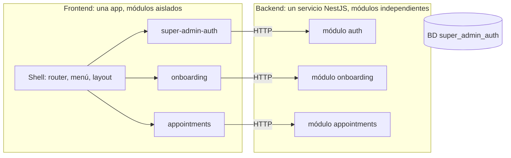

# Arquitectura: modular y "screaming"

Este documento define cómo se organiza el código del proyecto, tanto el backend
como el frontend. Reemplaza, para este proyecto, la organización por capas
técnicas que trae el scaffolding de WebIAI Elements.

## La idea en una frase

**Al abrir el repo, las carpetas deben decir qué hace la aplicación, no con qué
está hecha.** Se ve `super-admin-auth`, `appointments`, `referrals`; no se ve
`controllers`, `services`, `components`.

Y cada módulo es **independiente por código**: tiene su carpeta, sus rutas y sus
datos, y no depende de los demás. El backend es **un solo servicio** (un proceso, un
puerto, una base de datos) que reúne esos módulos; el frontend es una sola app con un
módulo por cada uno.

## Dónde estamos hoy

| Parte | Estado |
|-------|--------|
| Backend | Alineado: un **monolito modular**, `packages/services/necto-api`. Una sola aplicación (un proceso, un puerto, una conexión a MongoDB) con `platform/` (infraestructura transversal) y `modules/` (un módulo por capacidad: `auth` y `onboarding`), cada uno con sus capas y su puerta pública. |
| Frontend | Alineado para dos módulos: `src/modules/super-admin-auth/` (login y registro) y `src/modules/onboarding/` (bienvenida y pasos de perfil). `src/app/` registra los módulos (`modules.ts`) y renderiza sus rutas con carga diferida y `ModuleBoundary`. El resto del scaffolding de WebIAI Elements sigue organizado por tipo técnico (`pages/`, `elements/`, `shell/`...) y hace de base común. |

## Principios

1. **El nombre dice el dominio.** Las carpetas del primer nivel nombran
   capacidades del negocio (`appointments`, `auth`, `onboarding`), no tecnologías.
2. **Un módulo es dueño de todo lo suyo.** Su código, sus datos, su configuración
   y sus pruebas viven dentro de su carpeta.
3. **Los módulos son independientes por defecto.** Lo normal es que un módulo no
   importe a otro; si necesitan hablar, usan un contrato explícito (HTTP o
   eventos). Si en un caso concreto hace falta importar de otro módulo, **se
   permite**, con dos condiciones:
   - Se importa solo a través de su puerta pública (`index.ts` en el frontend),
     nunca a archivos internos.
   - Se anota en el README del módulo como dependencia.

   No hay una regla automática que lo impida: lo cuida la revisión del PR.
   Tenlo presente: cada import crea acoplamiento, y si el módulo importado falla
   o cambia, el que lo importa también se ve afectado.
4. **Lo compartido es mínimo y sin reglas de negocio.** Solo utilidades y piezas
   de interfaz genéricas.
5. **Un fallo se contiene en su módulo.** En el frontend, el `ErrorBoundary` aísla
   cada módulo. En el backend, un error en una petición de un módulo no afecta a las
   de otro; como todos comparten proceso, un fallo grave sí los tumba juntos (ver
   "Límites que conviene tener claros").
6. **Todo en inglés.** Nombres de módulos, carpetas, archivos, código, campos de
   la API, mensajes de error y comentarios. La documentación del repo está en
   español.



`appointments` es un ejemplo de módulo futuro. Las líneas son las
conexiones normales; un import entre módulos es la excepción (principio 3).

## Backend

### Un monolito modular

El backend es **una sola aplicación NestJS**: un proceso, un servidor HTTP con un puerto configurable, una conexión a
MongoDB, un `.env`, un secreto JWT y un solo arranque y despliegue. Operar una única aplicación es lo que mantiene bajo el
costo: nada de procesos, puertos, bases ni contraseñas por módulo.

Por dentro se organiza **por capacidad de negocio**. La independencia que se busca es de **responsabilidades y límites de
código**, no de procesos: un módulo es dueño de sus rutas, validaciones, casos de uso, reglas, datos y persistencia, y se
relaciona con los demás solo por contratos públicos.

```
packages/services/necto-api/           ← el backend (el nombre es el de la aplicación, no el de un módulo)
├── package.json  .env.example  README.md   ← el README trae el contrato HTTP de cada módulo
└── src/
    ├── main.ts                        ← arranque único
    ├── app.module.ts                  ← registra la plataforma y los módulos (una línea por módulo)
    ├── platform/                      ← infraestructura transversal, sin reglas de negocio
    │   ├── config/                    ← lee y valida el entorno
    │   ├── database/                  ← la única conexión a MongoDB
    │   ├── security/                  ← tokens, autenticación, autorización por rol, límite de peticiones
    │   ├── errors/                    ← errores de dominio -> respuestas HTTP
    │   └── observability/             ← GET /health
    └── modules/                       ← un módulo por capacidad de negocio
        ├── auth/
        │   ├── public.ts              ← puerta pública: lo único que otros pueden importar
        │   ├── auth.module.ts
        │   ├── api/                   ← controlador y DTOs
        │   ├── application/           ← casos de uso
        │   ├── domain/                ← entidades, reglas, errores y puertos (repositorios abstractos)
        │   └── infrastructure/        ← esquemas de Mongo y repositorios
        └── onboarding/ ...            ← misma forma

infra/                                 ← infraestructura de desarrollo compartida
├── docker-compose.yml                 ← MongoDB
└── mongo-init/                        ← crea la base y el usuario del backend
```

Se crean solo los módulos y las capas que tienen una responsabilidad real: un módulo pequeño puede no necesitar `domain/`,
y no se dejan carpetas vacías. Un módulo puede tener varios servicios, casos de uso, controladores y repositorios; no se
hace un módulo por cada clase `Service`.

### Reglas del backend

- **Un solo backend.** Los módulos no tienen servidor, puerto, secreto JWT, credenciales ni despliegue propios.
- **Puerta pública por módulo.** `modules/<módulo>/public.ts` expone solo lo que otros módulos necesitan (hoy, el módulo de
  Nest para registrarlo). Otro módulo o la aplicación importan **únicamente** `public.ts`; nunca los repositorios, esquemas,
  controladores ni implementaciones privadas. Independencia no significa "ningún módulo importa nada de otro": significa
  que las dependencias son explícitas, acotadas y apuntan a contratos públicos.
- **Sin ciclos.** Si dos módulos se necesitan mutuamente, se revisan las responsabilidades o se coordina el flujo desde un
  tercero. La comunicación interna es en memoria (inyección de dependencias, casos de uso exportados); no hay HTTP entre
  módulos ni infraestructura distribuida.
- **Sentido de las capas** dentro de un módulo: `api` e `infrastructure` -> `application` -> `domain`. El dominio no
  conoce a nadie; la aplicación habla con repositorios abstractos y nunca con Mongoose; los errores de negocio son
  `DomainError` (sin HTTP) y `platform/errors` los traduce a respuestas.
- **Un dueño por dato y por regla.** Cada colección tiene un único módulo propietario (`super_admins` -> `auth`,
  `onboarding_profiles` -> `onboarding`). Compartir la base y la conexión no da permiso para leer o escribir colecciones de
  otro módulo: si hace falta un dato ajeno, se pide por su contrato público.
- **Código compartido, solo si es transversal.** `platform/` contiene infraestructura (configuración, base, seguridad,
  errores, salud) y primitivas estables, sin reglas de negocio. Las reglas viven en su módulo propietario. No hay carpetas
  globales de `controllers/`, `services/` o `repositories/` que mezclen capacidades.
- **Nombre de la aplicación y nombre de la base son independientes.** La base se llama `super_admin_auth` por historia;
  el código solo conoce `MONGODB_URI`. Renombrar la app no obliga a migrar datos.
- **Configuración y salud únicas.** Un `.env` validado al arrancar y un `GET /health`.

Estas reglas las comprueba `src/architecture.spec.ts` (parte de `npm run test:api`).

### Autenticación y autorización

Tres responsabilidades separadas:

| Responsabilidad | Dónde | Detalle |
|-----------------|-------|---------|
| Identidad y sesión | `platform/security` | `AuthenticationGuard` verifica el token (HS256) y deja la identidad (`{ userId, role }`) en la petición. No decide sobre roles. |
| Autorización por rol | `platform/security` | `SuperAdminGuard` solo comprueba el rol `superadmin` de una identidad ya autenticada (`403` si es otro). Se usa con `@SuperAdminOnly()`. |
| Reglas de negocio | cada módulo | Qué rol recibe quien inicia sesión (`auth`), quién puede usar cada capacidad, unicidad del teléfono (`onboarding`)... |

El secreto JWT vive solo en `platform/security`. Los módulos reciben la identidad con `@CurrentUser()` y no validan el token
por su cuenta; `auth` pide un token con `TokenService.issue(...)`. Si algún día una parte se separa en su propio servicio,
convendría pasar a firma asimétrica (RS256 o EdDSA) para que solo el login tenga la clave privada.

## Frontend

### Un módulo = una carpeta autocontenida

Todo el código de negocio vive en `src/modules/`. El resto de `src/` es la base
común. Se conservan los nombres del scaffolding (`elements/`, `layouts/`,
`shell/`...) para no romper imports; funcionan como la capa compartida.

```
packages/apps/web/modules/app/src/
├── app/                           ← composición: router, providers, registro de módulos
├── shell/  layouts/  elements/    ← base común sin reglas de negocio (viene del scaffolding)
├── icons/  hooks/  utils/
└── modules/
    ├── super-admin-auth/
    │   ├── index.ts               ← API pública del módulo (lo único que se importa desde fuera)
    │   ├── pages/                 ← LoginPage, RegisterPage
    │   ├── components/
    │   ├── api/                   ← cliente HTTP de SUS rutas del backend
    │   ├── hooks/
    │   └── stores/
    └── appointments/ ...
```

### Reglas del frontend

- **Un módulo importa de sí mismo y de la base común.** Si necesita importar de
  otro módulo, solo por su `index.ts` y anotándolo en su README (principio 3).
- **`index.ts` es la única puerta.** Exporta la definición del módulo (rutas,
  entradas del menú). La app y los demás módulos lo usan solo por ahí.
- **La app compone, no implementa.** `app/` recorre los módulos registrados y
  arma rutas y menú; no contiene lógica de ningún módulo.
- **Cliente propio por módulo.** Cada módulo habla con el backend con su propia
  URL base (`VITE_<MODULE>_API_URL`, por ejemplo `VITE_SUPER_ADMIN_AUTH_API_URL` y
  `VITE_ONBOARDING_API_URL`; hoy apuntan al mismo backend), con timeout y estados de
  error explícitos.
- **Rutas aisladas.** Cada módulo se carga con `lazy` y cada ruta va envuelta en
  un `ErrorBoundary`. Si un módulo lanza un error al renderizar o su código no
  carga, solo se ve el aviso de error de ese módulo; el menú y los demás módulos
  siguen operativos.

```tsx
// modules/super-admin-auth/index.ts: what the module offers to the app
export const superAdminAuthModule = {
  id: "super-admin-auth",
  routes: [
    { path: "/super/login", component: lazy(() => import("./pages/LoginPage")) },
    { path: "/super/register", component: lazy(() => import("./pages/RegisterPage")) },
  ],
};
```

## Qué pasa cuando algo falla

| Si falla... | Qué ocurre |
|-------------|------------|
| Un error en una petición de un módulo del backend | Se responde con error solo esa petición. Las de otros módulos siguen. |
| Un fallo grave del proceso del backend (se cae o se cuelga) | Se caen **todos** los módulos del backend a la vez. El frontend sigue cargando y cada módulo muestra su estado de error. |
| La base de datos | Afecta a todo el backend. |
| Un módulo del frontend (error al renderizar) | El `ErrorBoundary` lo contiene. Se muestra un aviso en esa zona y el resto de la app funciona. |
| El backend, visto desde el frontend | Cada módulo muestra su estado de error o de "no disponible"; la app no se rompe. |

### Límites que conviene tener claros

- **Un solo proceso significa un solo punto de falla en el backend.** Es una decisión
  consciente a cambio de operar un único servicio. La separación por carpetas protege
  el código (cada módulo se entiende, prueba y cambia por separado), no el tiempo de
  actividad. Si más adelante un módulo necesita aislarse, su carpeta ya está lista para
  sacarla a un servicio propio.
- **Una sola instancia de MongoDB** sirve al backend en desarrollo. Si ese contenedor
  cae, cae todo. En producción, el aislamiento completo exige instancias o clústeres
  separados.
- **El frontend es una sola aplicación y un solo build.** El `ErrorBoundary` y la
  carga diferida protegen contra errores en ejecución, pero un error de
  compilación en un módulo detiene el build de toda la app. Separar el frontend
  en aplicaciones desplegables por módulo (micro-frontends) es posible más
  adelante, y esta estructura ya lo permite, pero hoy no se justifica.
- **Los imports entre módulos reducen el aislamiento.** Cada uno que se permita
  es una dependencia donde un fallo puede propagarse. En el backend no se permiten
  (usa un módulo común); en el frontend se permiten por la puerta pública.
- **Un punto de entrada común** (gateway o balanceador) pasa a ser un punto
  único de fallo si no se replica. Hoy no existe: el frontend llama al backend
  directamente.

## Cómo agregar un módulo

**Backend**

1. Crear `src/modules/<módulo>/` con `<módulo>.module.ts` y `public.ts` (que exporte el módulo), y solo las capas que tengan
   una responsabilidad real (`api`, `application`, `domain`, `infrastructure`).
2. Registrarlo en `app.module.ts` importándolo desde `./modules/<módulo>/public`.
3. Rutas bajo un prefijo propio (`/<módulo>/...`) y colecciones propias en la misma base.
4. Para proteger rutas, importar `SecurityModule` y usar `@SuperAdminOnly()`; tomar la identidad con `@CurrentUser()`.
5. Si necesita algo de otro módulo, importar **solo su `public.ts`**. Lo transversal sin reglas de negocio va a `platform/`.
6. Documentar su contrato HTTP en el README del backend y correr `npm run test:api`.

**Frontend**

1. Crear `src/modules/<module>/` con `index.ts`, `pages/`, `api/` y lo que haga
   falta.
2. Exportar la definición del módulo (rutas y entrada de menú) desde `index.ts`.
3. Registrarlo en `src/app/` (una línea).

## Decisiones tomadas

- **Idioma:** todo el código y los nombres, en inglés.
- **Límites entre módulos del backend:** se comprueban con pruebas (`src/architecture.spec.ts`), no con un linter.
  Un módulo solo importa a otro por su `public.ts`. En el frontend, los imports entre módulos se permiten por su
  `index.ts` y declarados en el README.

## Pendiente

- **Firma asimétrica del JWT**, solo si alguna parte se separa en su propio servicio.
- **Pruebas de integración con MongoDB** (índices únicos y carreras de escritura): hoy se verifican a mano levantando el backend.
- **Contratos públicos entre módulos:** hoy ningún módulo necesita algo de otro, así que las puertas públicas solo exportan el
  módulo. Se amplían cuando aparezca el primer consumidor real.
