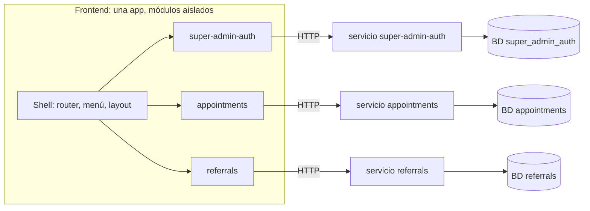

# Arquitectura: modular y "screaming"

Este documento define cómo se organiza el código del proyecto, tanto el backend
como el frontend. Reemplaza, para este proyecto, la organización por capas
técnicas que trae el scaffolding de WebIAI Elements.

## La idea en una frase

**Al abrir el repo, las carpetas deben decir qué hace la aplicación, no con qué
está hecha.** Se ve `super-admin-auth`, `appointments`, `referrals`; no se ve
`controllers`, `services`, `components`.

Y cada módulo es **independiente**: si uno falla, los demás siguen funcionando.

## Dónde estamos hoy

| Parte | Estado |
|-------|--------|
| Backend | Alineado. Dos servicios propios, cada uno con su base y su usuario de base de datos: `packages/services/super-admin-auth` (login del superadmin) y `packages/services/onboarding` (teléfono y origen del usuario tras el primer login). |
| Frontend | Alineado para dos módulos: `src/modules/super-admin-auth/` (login y registro) y `src/modules/onboarding/` (bienvenida y pasos de perfil). `src/app/` registra los módulos (`modules.ts`) y renderiza sus rutas con carga diferida y `ModuleBoundary`. El resto del scaffolding de WebIAI Elements sigue organizado por tipo técnico (`pages/`, `elements/`, `shell/`...) y hace de base común. |

## Principios

1. **El nombre dice el dominio.** Las carpetas del primer nivel nombran
   capacidades del negocio (`appointments`, `super-admin-auth`), no tecnologías.
2. **Un módulo es dueño de todo lo suyo.** Su código, sus datos, su configuración
   y sus pruebas viven dentro de su carpeta.
3. **Los módulos son independientes por defecto.** Lo normal es que un módulo no
   importe a otro; si necesitan hablar, usan un contrato explícito (HTTP o
   eventos). Si en un caso concreto hace falta importar de otro módulo, **se
   permite**, con dos condiciones:
   - Se importa solo a través de su puerta pública (`index.ts` en el frontend),
     nunca a archivos internos.
   - Se anota en el README del módulo como dependencia.

   No hay una regla automática que lo impida: lo cuida la revisión del PR.
   Tenlo presente: cada import crea acoplamiento, y si el módulo importado falla
   o cambia, el que lo importa también se ve afectado.
4. **Lo compartido es mínimo y sin reglas de negocio.** Solo utilidades y piezas
   de interfaz genéricas.
5. **Un fallo se contiene en su módulo.** Ningún módulo debe poder tumbar a otro
   ni a la aplicación completa.
6. **Todo en inglés.** Nombres de módulos, carpetas, archivos, código, campos de
   la API, mensajes de error y comentarios. La documentación del repo está en
   español.



`appointments` y `referrals` son ejemplos de módulos futuros. Las líneas son las
conexiones normales; un import entre módulos es la excepción (principio 3).

## Backend

### Un módulo = un servicio

Cada módulo de negocio es un **servicio independiente**: su propia app NestJS, su
propio proceso, su propio puerto, su propia base de datos y su propia
configuración.

```
packages/services/
├── onboarding/                    ← servicio del perfil de bienvenida: teléfono y origen (existe hoy)
│   └── ...                        ← misma forma que super-admin-auth (auth/ solo verifica el token)
└── super-admin-auth/              ← servicio del login del superadmin (existe hoy)
    ├── package.json
    ├── .env.example
    ├── README.md                  ← incluye el contrato HTTP del servicio
    └── src/
        ├── main.ts                ← arranque propio
        ├── app.module.ts
        ├── config/                ← validación de SU entorno
        ├── health.controller.ts
        ├── auth/                  ← registro, login, guard
        └── super-admin/           ← esquema de Mongo y acceso a datos

infra/                             ← infraestructura de desarrollo compartida
├── docker-compose.yml             ← MongoDB
└── mongo-init/                    ← crea una base y un usuario por servicio
```

Servicios futuros (`business-admin-auth`, `appointments`...) siguen la misma forma.

Dentro de un módulo pequeño se permite agrupar por tipo técnico (`dto/`,
`schemas/`, `guards/`). Cuando el módulo crece, se divide en submódulos por
capacidad (`registration/`, `login/`), siguiendo el mismo principio.

### Reglas del backend

- **Base de datos propia.** Cada servicio usa su propia base (`super_admin_auth`,
  `appointments`...) con su propio usuario, que solo tiene permiso sobre esa base.
  Ningún servicio lee o escribe las colecciones de otro.
- **Configuración propia.** Cada servicio tiene su `.env` y valida solo sus
  variables al arrancar.
- **Salud propia.** Cada servicio expone `GET /health`.
- **Comunicación por contrato.** Entre servicios no se importa código fuente: se
  llama a su API por HTTP, con timeout y manejo de error explícito (o por eventos
  más adelante). El contrato de cada servicio está en su README.
- **Código común, solo si hace falta.** Va en una librería mínima
  (`packages/shared/`) con tipos o utilidades puras, versionada. Sin reglas de
  negocio.

### Autenticación entre servicios

Para que la caída del servicio de login no tumbe a los demás, los otros servicios
deben poder **validar un token sin llamar al servicio que lo emitió**.

- **Hoy:** el token se firma con un secreto compartido (HS256). `onboarding` ya es un
  segundo servicio y valida el token con **el mismo `JWT_SECRET`**, sin llamar a
  `super-admin-auth`. Funciona, pero quien tenga el secreto puede firmar tokens: es
  provisional.
- **Siguiente paso (ya hay un segundo servicio):** pasar a firma asimétrica (RS256 o
  EdDSA). El servicio de login firma con la clave privada y los demás solo
  necesitan la clave pública. Así un servicio de login caído solo impide nuevos
  inicios de sesión; quien ya tiene un token vigente sigue trabajando.

## Frontend

### Un módulo = una carpeta autocontenida

Todo el código de negocio vive en `src/modules/`. El resto de `src/` es la base
común. Se conservan los nombres del scaffolding (`elements/`, `layouts/`,
`shell/`...) para no romper imports; funcionan como la capa compartida.

```
packages/apps/web/modules/app/src/
├── app/                           ← composición: router, providers, registro de módulos
├── shell/  layouts/  elements/    ← base común sin reglas de negocio (viene del scaffolding)
├── icons/  hooks/  utils/
└── modules/
    ├── super-admin-auth/
    │   ├── index.ts               ← API pública del módulo (lo único que se importa desde fuera)
    │   ├── pages/                 ← LoginPage, RegisterPage
    │   ├── components/
    │   ├── api/                   ← cliente HTTP de SU servicio
    │   ├── hooks/
    │   └── stores/
    └── appointments/ ...
```

### Reglas del frontend

- **Un módulo importa de sí mismo y de la base común.** Si necesita importar de
  otro módulo, solo por su `index.ts` y anotándolo en su README (principio 3).
- **`index.ts` es la única puerta.** Exporta la definición del módulo (rutas,
  entradas del menú). La app y los demás módulos lo usan solo por ahí.
- **La app compone, no implementa.** `app/` recorre los módulos registrados y
  arma rutas y menú; no contiene lógica de ningún módulo.
- **Cliente propio por módulo.** Cada módulo habla con su servicio con su propia
  URL base (`VITE_<MODULE>_API_URL`, por ejemplo `VITE_SUPER_ADMIN_AUTH_API_URL`),
  con timeout y estados de error explícitos.
- **Rutas aisladas.** Cada módulo se carga con `lazy` y cada ruta va envuelta en
  un `ErrorBoundary`. Si un módulo lanza un error al renderizar o su código no
  carga, solo se ve el aviso de error de ese módulo; el menú y los demás módulos
  siguen operativos.

```tsx
// modules/super-admin-auth/index.ts: what the module offers to the app
export const superAdminAuthModule = {
  id: "super-admin-auth",
  routes: [
    { path: "/super/login", component: lazy(() => import("./pages/LoginPage")) },
    { path: "/super/register", component: lazy(() => import("./pages/RegisterPage")) },
  ],
};
```

## Qué pasa cuando algo falla

| Si falla... | Qué ocurre |
|-------------|------------|
| Un servicio de backend (proceso) | Solo ese módulo deja de responder. Los demás servicios y el frontend siguen. |
| La base de datos de un servicio | Solo afecta a ese servicio. |
| El servicio de login | No se pueden iniciar sesiones nuevas. Con firma asimétrica, quien ya tiene token sigue trabajando en los demás módulos hasta que expire. |
| Un módulo del frontend (error al renderizar) | El `ErrorBoundary` lo contiene. Se muestra un aviso en esa zona y el resto de la app funciona. |
| El servicio de un módulo, visto desde el frontend | El módulo muestra su estado de error o de "no disponible"; la app no se rompe. |

### Límites que conviene tener claros

- **Aislamiento real requiere procesos separados.** Si todos los módulos del
  backend corrieran en un mismo proceso, un fallo grave los tumbaría juntos
  aunque el código esté bien separado. Por eso la regla es un servicio por
  proceso.
- **En desarrollo, una sola instancia de MongoDB** sirve varias bases (una por
  servicio, cada una con su usuario). Si ese contenedor cae, caen todos. En
  producción, el aislamiento completo exige instancias o clústeres separados.
- **El frontend es una sola aplicación y un solo build.** El `ErrorBoundary` y la
  carga diferida protegen contra errores en ejecución, pero un error de
  compilación en un módulo detiene el build de toda la app. Separar el frontend
  en aplicaciones desplegables por módulo (micro-frontends) es posible más
  adelante, y esta estructura ya lo permite, pero hoy no se justifica.
- **Los imports entre módulos reducen el aislamiento.** Cada uno que se permita
  es una dependencia donde un fallo puede propagarse.
- **Un punto de entrada común** (gateway o balanceador) pasa a ser un punto
  único de fallo si no se replica. Hoy no existe: el frontend llama a cada
  servicio directamente.

## Cómo agregar un módulo

**Backend**

1. Crear `packages/services/<module>/` como app NestJS con su `package.json`,
   `.env.example` y `README.md`.
2. Agregar su base y su usuario en `infra/mongo-init/` y su contraseña en
   `infra/docker-compose.yml` e `infra/.env.example`.
3. Definir su puerto propio, exponer `GET /health` y documentar su contrato HTTP
   en el README.
4. Si necesita datos de otro módulo, usar su API.

**Frontend**

1. Crear `src/modules/<module>/` con `index.ts`, `pages/`, `api/` y lo que haga
   falta.
2. Exportar la definición del módulo (rutas y entrada de menú) desde `index.ts`.
3. Registrarlo en `src/app/` (una línea).

## Decisiones tomadas

- **Idioma:** todo el código y los nombres, en inglés.
- **Sin lint de límites entre módulos.** Se permiten imports entre módulos cuando
  haga falta, por la puerta pública y declarados en el README.

## Pendiente

- **Cómo se ejecutan varios servicios en local.** Hoy hay dos servicios y se
  levantan por separado (`npm run dev:super-admin-auth` y `npm run dev:onboarding`). Con más, un script que los
  levante todos con `concurrently`, o un `docker-compose.yml` en la raíz.
- **Firma asimétrica del JWT**: el segundo servicio (`onboarding`) ya existe y hoy comparte el secreto.
