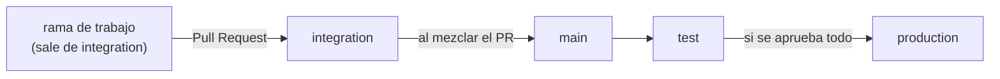

# Flujo de ramas y Pull Requests

Este repo centraliza los módulos de todo el equipo. Para que varios trabajemos
sobre la misma base sin pisarnos, el código viaja siempre por el mismo camino de
ramas.

## Las ramas

| Rama | Para qué sirve | ¿Se trabaja directo? |
|------|----------------|----------------------|
| `integration` | Rama de trabajo del equipo. Todos los PRs llegan aquí. De ella se crean las ramas nuevas. | No se commitea directo: se entra por PR. |
| `main` | Rama estable. No se toca a mano. Siempre queda a la misma altura que `integration`. | No. |
| `test` | Ambiente de pruebas. Recibe lo que hay en `main`. | No. |
| `production` | Lo que está en producción. Solo recibe lo que se aprobó en `test`. | No. |

## El camino del código



1. Creas tu rama de trabajo a partir de `integration`.
2. Trabajas ahí y abres un **Pull Request hacia `integration`**.
3. Cuando el PR se mezcla en `integration`, ese cambio se envía a **`main`**.
   `integration` y `main` quedan siempre a la misma altura.
4. Después de actualizarse `main`, se envía a **`test`**.
5. Si en `test` se aprueba todo, se envía a **`production`**.

El código solo avanza en un sentido. Nada se mezcla a mano en `main`, `test` ni
`production`.

## Trabajar día a día

```bash
# 1. Actualiza integration
git checkout integration
git pull

# 2. Crea tu rama de trabajo
git checkout -b feat/nombre-corto

# 3. Trabaja, haz commits y súbela
git push -u origin feat/nombre-corto

# 4. Abre el PR hacia integration
gh pr create --base integration
```

## Nomenclatura de ramas

El nombre de cada rama de trabajo lleva un prefijo que indica qué tipo de cambio
contiene, seguido de una descripción corta.

| Prefijo | Para qué se usa | Ejemplo |
|---------|-----------------|---------|
| `feat/` o `feature/` | Desarrollo de una nueva funcionalidad. | `feature/add-login-page` |
| `fix/` o `bugfix/` | Corrección de un error o fallo en el código. | `bugfix/fix-header-bug` |
| `hotfix/` | Corrección urgente de un error crítico directamente en producción. | `hotfix/security-patch` |
| `release/` | Preparación para una nueva versión o despliegue a producción. | `release/v1.2.0` |
| `docs/` | Cambios exclusivos en la documentación. | `docs/nomenclatura` |
| `refactor/` | Mejora de código sin alterar su funcionalidad externa. | `refactor/split-sidebar` |
| `chore/` | Tareas de mantenimiento, actualización de dependencias o configuración. | `chore/update-dependencies` |

Reglas del nombre:

- Todo en minúsculas y con guiones para separar palabras (`add-login-page`, no
  `AddLoginPage`).
- Corto y descriptivo: debe bastar para saber de qué trata el cambio.

Notas sobre este repo:

- **Todas las ramas salen de `integration`, incluida `hotfix/`.** Producción solo
  recibe código por la promoción `test → production`, así que un hotfix también
  entra por PR a `integration` y baja por el mismo camino.

## Ramas end to end

Cada rama que entrega una funcionalidad se trabaja **completa**: backend,
frontend y documentación viajan juntos en la misma rama y en el mismo PR.

- No se abren ramas separadas "solo backend" y "solo frontend" para una misma
  funcionalidad. Una funcionalidad no llega a `integration` a medias.
- Antes de abrir el PR, la funcionalidad debe funcionar de punta a punta: desde
  la pantalla hasta la base de datos.
- Si una funcionalidad es grande, se divide en **rebanadas verticales**: cada
  rebanada es end to end y más pequeña (por ejemplo, "login" y luego "recuperar
  contraseña"), no en capas ("primero todo el backend").

Qué debe llevar el PR de una funcionalidad:

| Parte | Qué incluye |
|-------|-------------|
| Backend | El servicio o los endpoints, con sus variables de entorno en `.env.example`. |
| Frontend | Las pantallas y el cliente que consume el backend. |
| Documentación | El contrato HTTP en el README del servicio y los docs que cambien (`docs/`, README). Si el cambio altera el estado del proyecto, actualiza también [`ai-context.md`](ai-context.md). |
| Verificación | Probado de punta a punta, indicando en el PR cómo se probó. |

Esta regla aplica a las ramas que entregan o corrigen funcionalidad (`feature/`,
`feat/`, `fix/`, `bugfix/`, `hotfix/`). Las ramas que por definición tocan solo una
parte (`docs/`, `refactor/`, `chore/`, `release/`) no necesitan las tres.

## Promociones entre ramas (GitHub Actions)

Las promociones avanzan la rama destino al **mismo commit** con fast-forward, sin
crear commits nuevos ni usar force. Por eso `integration`, `main` y `test` quedan
siempre a la misma altura.

| Paso | Cómo se ejecuta | Workflow |
|------|-----------------|----------|
| `integration` → `main` → `test` | Automático al mezclar un PR en `integration` | `.github/workflows/promover-a-main-y-test.yml` |
| `test` → `production` | Manual, solo cuando `test` fue aprobado | `.github/workflows/promover-a-production.yml` |

**Pasar a producción:** en GitHub ve a *Actions → Promover test -> production →
Run workflow*, escribe `PRODUCCION` en el campo de confirmación y ejecuta. Quien
lo ejecuta es quien aprueba; queda registrado con su usuario en el historial.

Si `main` o `test` tuvieran un commit que `integration` no tiene (alguien empujó
directo), el push se rechaza y el workflow falla. Hay que corregirlo a mano antes
de seguir; el workflow nunca pisa historial.

## Reglas de protección configuradas

Están creadas como rulesets del repo (*Settings → Rules → Rulesets*):

- **`integration-solo-por-pr`**: todo cambio entra por Pull Request con 1
  aprobación. La revisión es cruzada: nadie aprueba su propio PR, así que cada
  persona revisa los PRs de la otra. Se descartan las aprobaciones si llegan
  commits nuevos, las conversaciones deben quedar resueltas y no se permite force
  push ni borrar la rama.

  **Excepción para administradores:** quien tenga rol Admin puede mezclar su PR
  sin esperar la aprobación (por ejemplo, si el compañero no está disponible). La
  excepción es solo vía PR: no permite empujar directo a `integration`. Para
  usarla, en la página del PR pulsa **Merge without waiting for requirements**, o
  desde la terminal:

  ```bash
  gh pr merge <numero> --squash --admin
  ```

  Úsala como último recurso. Lo normal es la revisión cruzada.
- **`main-test-production-historial-protegido`**: no se permite force push, borrar
  las ramas ni historial con merge commits.

Limitación conocida: `main`, `test` y `production` **no** bloquean pushes
directos. El token de Actions no se puede añadir a la lista de excepciones de un
ruleset, así que un bloqueo total impediría que los workflows las avancen. Para
cerrarlo hace falta una GitHub App o un bot con permiso de excepción.

## Pendiente de definir

- Con qué criterio se aprueba el paso de `test` a `production`.
- Si se agrega un workflow de CI (typecheck y build) que corra en cada PR.
