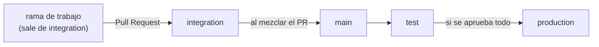

# Flujo de ramas y Pull Requests

Este repo centraliza los módulos de todo el equipo. Para que varios trabajemos
sobre la misma base sin pisarnos, el código viaja siempre por el mismo camino de
ramas.

## Las ramas

| Rama | Para qué sirve | ¿Se trabaja directo? |
|------|----------------|----------------------|
| `integration` | Rama de trabajo del equipo. Todos los PRs llegan aquí. De ella se crean las ramas nuevas. | No se commitea directo: se entra por PR. |
| `main` | Rama estable. No se toca a mano. Siempre queda a la misma altura que `integration`. | No. |
| `test` | Ambiente de pruebas. Recibe lo que hay en `main`. | No. |
| `production` | Lo que está en producción. Solo recibe lo que se aprobó en `test`. | No. |

## El camino del código



1. Creas tu rama de trabajo a partir de `integration`.
2. Trabajas ahí y abres un **Pull Request hacia `integration`**.
3. Cuando el PR se mezcla en `integration`, ese cambio se envía a **`main`**.
   `integration` y `main` quedan siempre a la misma altura.
4. Después de actualizarse `main`, se envía a **`test`**.
5. Si en `test` se aprueba todo, se envía a **`production`**.

El código solo avanza en un sentido. Nada se mezcla a mano en `main`, `test` ni
`production`.

## Trabajar día a día

```bash
# 1. Actualiza integration
git checkout integration
git pull

# 2. Crea tu rama de trabajo
git checkout -b feat/nombre-corto

# 3. Trabaja, haz commits y súbela
git push -u origin feat/nombre-corto

# 4. Abre el PR hacia integration
gh pr create --base integration
```

Convención sugerida para el nombre de la rama: `feat/...`, `fix/...`, `docs/...`.

## Protección de ramas (configurar en GitHub)

Estas reglas se configuran en *Settings → Branches* del repo (requiere permisos
de administrador) y son las que hacen cumplir el flujo:

- `integration`: exigir Pull Request y al menos una aprobación antes de mezclar.
- `main`, `test` y `production`: bloquear pushes directos de personas.

## Pendiente de definir

- **Cómo se ejecutan las promociones** `integration → main → test → production`
  (automatizadas con GitHub Actions o manuales). Lo que importa para el flujo es
  que `main` termine a la misma altura que `integration`.
- Quién aprueba el paso de `test` a `production` y con qué criterio.
